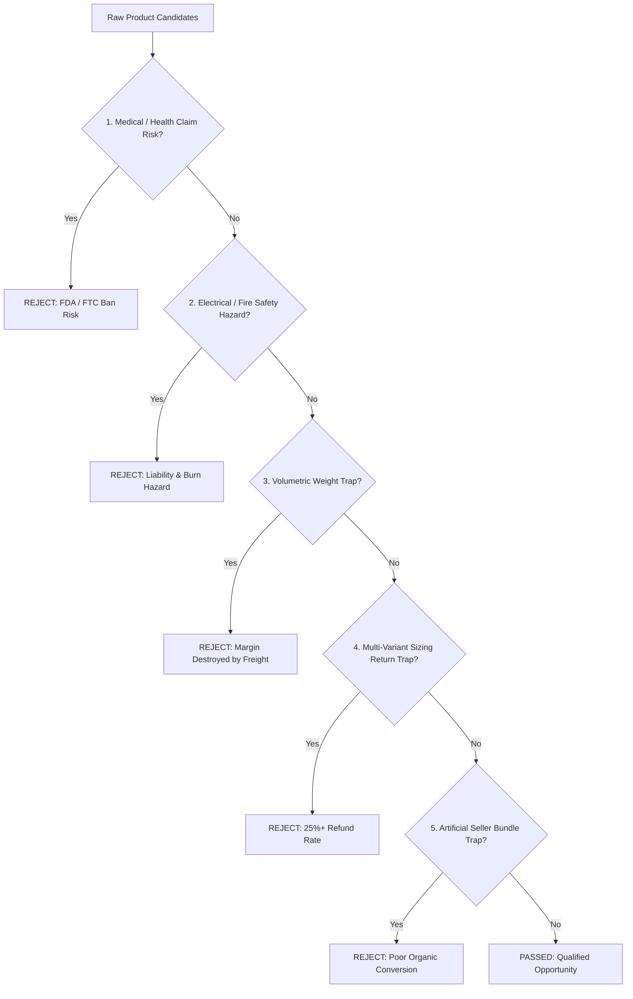

# US WIN HUNTER — SKEPTICAL FAILURE & RISK ANALYSIS
## Post-Mortem of Rejected Candidates, False Positives, Safety Hazards & Operational Traps

**Project:** US WIN HUNTER  
**Role:** Skeptical Investment & Risk Review Committee  
**Target Market:** United States  
**Classification:** Product Safety, Legal Compliance & Unit Economics Defense  
**Date:** November 2026  

---

## 1. Executive Mandate

The highest cost in e-commerce dropshipping is not failed data scrapers; it is **spending thousands of advertising dollars promoting products destined for high chargebacks, account bans, customs confiscations, or product liability lawsuits**.

As the Skeptical Investment Committee, our role is to actively stress-test every candidate opportunity and reject false positives before capital is committed to media buying.

---

## 2. Taxonomy of False Positives & Rejection Filters

---

## 3. Case Studies of Rejected False Positives

### Case 1: The "Arthritis-Curing" Pet Thermal Pad
- **The Pitch:** Dropship merchants marketing pet electric pads with claims like *"Clinically proven to cure canine arthritis and hip dysplasia in 14 days"*.
- **The Skeptical Audit:**
  - **Regulatory Violation:** Under US FTC and FDA guidelines (Section 5 FTC Act), claiming a non-prescription heated pad "cures" or "reverses" degenerative joint disease is an illegal, unsubstantiated medical claim. Meta and TikTok algorithms aggressively flag and ban ad accounts making clinical cure promises for pet products.
  - **Safety Hazard:** Cheap heating pads without thermal fuses can reach internal temperatures of 135°F+ (57°C), causing contact skin burns on elderly, immobile dogs who cannot move away easily.
  - **Correction & Mitigation:** Reposition strictly as a **thermal comfort pad** for winter warmth and soothing senior pet relaxation. Mandate dual internal thermostats capped at 104°F (40°C), chew-resistant steel cord wrapping, and flame-retardant PVC.

---

### Case 2: Artificial "Buy 2 Mops Get 1 Free" Bulk Mop Handles
- **The Pitch:** Selling 2 or 3 complete flat mop handle assemblies for \$49.99 under a "Buy 2 Get 1 Free" banner.
- **The Skeptical Audit:**
  - **Artificial Bundle Trap:** A standard household has only one primary floor cleaner person and requires only **one mop handle**. Forcing the customer to buy 3 long steel poles offers zero organic utility—nobody needs a mop handle in the bedroom closet, another in the garage, and a third in the attic.
  - **Conversion Disaster:** Customers abandon carts when they realize they are paying \$49.99 for redundant hardware they don't need, rather than getting affordable replacement heads.
  - **Correction & Mitigation:** Sell **one hero mop handle paired with 5 to 10 consumable microfiber pads** (Model C), or sell replacement heads directly (Model B).

---

### Case 3: Waterproof Silicone Dog Rain Boots (Sizing Return Disaster)
- **The Pitch:** 4-piece silicone dog boots to protect paws from winter road salt and rain (\$24.99).
- **The Skeptical Audit:**
  - **The Sizing Trap:** Canine paws vary drastically not just by breed, but between front and hind paws on the same animal. Without rigorous paw measuring, over 35% of customers receive boots that either pinch circulation or slip off during the first walk.
  - **Behavioral Rejection:** 70% of dogs freeze or thrash erratically when boots are placed on their feet. Customers immediately demand refunds within 48 hours of delivery.
  - **Refund Rate:** Estimated **28%–38% return rate**, completely wiping out gross profits.
  - **Verdict:** **PERMANENT REJECTION** for dropshipping. Sizing-sensitive pet apparel is an operational minefield.

---

### Case 4: Ultrasonic Pest Repellers
- **The Pitch:** Wall plug-in devices claiming to emit high-frequency sound waves that drive away mice, roaches, and spiders (\$39.99 for 4-pack).
- **The Skeptical Audit:**
  - **FTC Regulatory History:** The FTC has repeatedly sued and fined manufacturers of ultrasonic pest repellers for false and deceptive advertising, citing lack of scientific evidence.
  - **Customer Rage:** Pests do not leave; customer chargeback rates frequently exceed 5%, resulting in Stripe/PayPal payment gateway holds and frozen merchant funds.
  - **Verdict:** **PERMANENT REJECTION** as fraudulent pseudoscience.

---

### Case 5: The "Cheap Plastic Cat Fountain" (Feline Chin Acne Trap)
- **The Pitch:** Selling \$14.99 injection-molded plastic pet water fountains.
- **The Skeptical Audit:**
  - **Bacterial Problem:** Plastic is porous and develops micro-scratches from sponges. Feline saliva and tap water combine in these scratches to breed *Pseudomonas* bacteria, causing severe blackhead feline chin acne that requires veterinary antibiotics.
  - **Reputational Damage:** Negative customer reviews with photos of bleeding cat chins destroy brand conversion within 6 weeks of launch.
  - **Verdict:** **REJECT PLASTIC FOUNTAINS**. Only stainless steel (Grade 304) or ceramic fountains are approved for commercial dropshipping.

---

## 4. Supply Chain & Unit Economics Traps

### The Dimensional Weight (DIM Weight) Surcharge Trap
Standard dropshipping shipping lines (CJPacket, YunExpress, 4PX) charge freight based on the greater of **actual gross weight** vs **volumetric dimensional weight**:

$$\text{Dimensional Weight (kg)} = \frac{L \times W \times H \text{ (cm)}}{6000 \text{ or } 5000}$$

| Product | Actual Weight | Packaged Box Dimensions | Volumetric Weight | Billable Freight Cost | Margin Impact |
|---|:---:|:---:|:---:|:---:|:---:|
| **Standard Dog Pee Pads (3-Pk Vacuum Packed)** | 0.95 kg | $26 \times 20 \times 8\text{ cm}$ | **0.83 kg** | **\$7.80** | **SAFE (Billed on actual weight)** |
| **Damaged Screw Extractor (Case)** | 0.28 kg | $12 \times 9 \times 4\text{ cm}$ | **0.09 kg** | **\$3.90** | **EXCELLENT (Ultra-compact)** |
| **Assembled Plastic Dog Bed** | 1.80 kg | $65 \times 50 \times 25\text{ cm}$ | **16.25 kg** | **\$78.00+** | **FATAL: Shipping cost exceeds retail price!** |
| **Elevated Dog Feeder (Non-Knockdown)** | 2.20 kg | $48 \times 32 \times 28\text{ cm}$ | **8.60 kg** | **\$38.50** | **FATAL: Destroys product margin** |
| **Elevated Dog Feeder (Flat-Pack Knockdown)** | 2.20 kg | $45 \times 28 \times 8\text{ cm}$ | **2.01 kg** | **\$14.50** | **VIABLE: Flat-pack saves \$24 in freight** |

> [!CAUTION]
> Never import or dropship rigid furniture or large hollow containers without confirming that the factory packs the product completely flat (knockdown construction).

---

## 5. Intellectual Property & Brand Safety Hazards

To prevent copyright takedowns (DMCA) and patent infringement lawsuits under US federal jurisdiction:

1. **Avoid Branded Trademark Cloning:**
   - Never use "O-Cedar" in product titles or ad copy (use *"Replacement heads compatible with standard triangular spin mops"*).
   - Never use "Gorilla Grip" for rug pads (use *"Heavy-duty non-slip rug grippers"*).
   - Never use "Swiffer" for flat mops (use *"Hands-free microfiber flat mop"*).
2. **Design Patent Infringement:**
   - Verify that mop head plastic clip rings do not violate active utility patents.
   - For screw extractors, standard double-ended spiral fluting is in the public domain, but specific handle locking mechanism patents must be checked.

---

## 6. Pre-Launch Quality Assurance Checklist

Before launching ad spend on any winning candidate, the operator must complete this 6-point verification gate:

- [ ] **Sample Stress Test:** Physically drill into a stripped grade-8 bolt (Screw Extractor) or machine-wash 10 times at 120°F (Pee Pads) to verify real-world durability.
- [ ] **Electrical Certification Check:** For heating pads/fountains, verify authentic CE/FCC/RoHS and UL/ETL test reports with verified certificate numbers.
- [ ] **Ad Copy Compliance Audit:** Zero claims of "curing", "healing", "medical diagnosis", or "guaranteed pest elimination".
- [ ] **Box Dimensions Verification:** Packaged carton dimensions confirmed under $35 \times 25 \times 12\text{ cm}$ to avoid volumetric freight penalties.
- [ ] **Unboxing Experience:** Ensure English instruction manuals with clear assembly diagrams are included inside the factory packaging.
- [ ] **Payment Gateway Buffer:** Maintain a minimum 10% reserve for refund/chargeback allowances during the first 60 days of campaign scaling.

