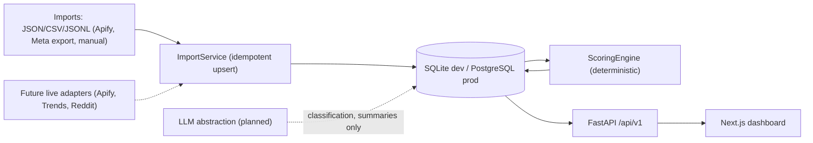

# System Architecture

## Components
| Layer | Tech | Status |
|---|---|---|
| API | FastAPI + Pydantic v2 | Implemented |
| ORM | SQLAlchemy 2 async | Implemented (24 tables) |
| DB | SQLite (aiosqlite) locally; PostgreSQL via `DATABASE_URL` | SQLite verified |
| Jobs | `collection_jobs` / `collection_runs` tables; in-process execution | Import runs only |
| Scoring | `app/engines/scoring.py` | Implemented |
| Frontend | Next.js + TS + Tailwind | Phase 1 slice |
| Migrations | Alembic | Planned; dev uses `create_all` |

## Deviations from preferred stack
- **No Docker on the dev machine** → Docker Compose/Redis/Celery deferred. Single-operator workload doesn't justify Celery yet.
- **Python 3.14** in use (spec asked 3.12+).
- LLMs are never used for measurements or scores.

